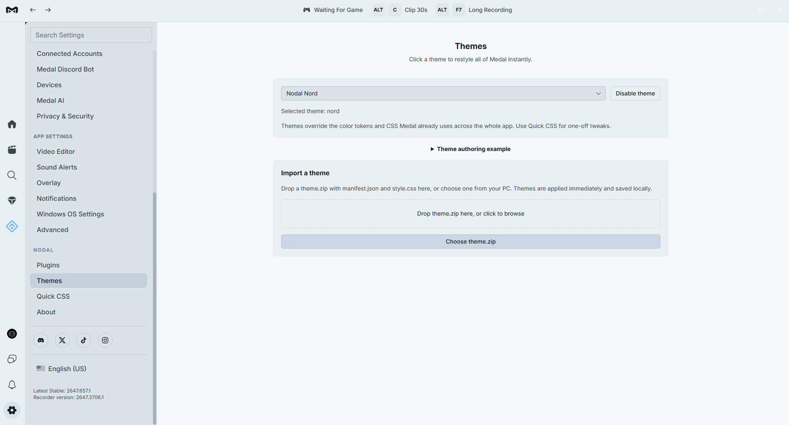

# Nodal

Nodal extends the functionality of Medal by enhancing it with new features.

## Install

Download the latest release from [GitHub Releases](https://github.com/krushna06/Nodal/releases) and run `NodalInstaller.exe`.
To install from source:

Run from the repo root:

```powershell
powershell -NoProfile -ExecutionPolicy Bypass -File .\installer\install.ps1
```

Menu:

```text
Use the arrow keys to navigate: ↓ ↑ → ←
? What would you like to do? (Press Enter to confirm):
  > Install Nodal
    Repair Nodal
    Uninstall Nodal
```

## Screenshots

<table>
  <tr>
    <td colspan="2" align="center"><b>Plugins</b><br></td>
  </tr>
  <tr>
    <td align="center"><b>Theme 1</b><br></td>
    <td align="center"><b>Theme 2</b><br></td>
  </tr>
</table>

## Development

```powershell
powershell -NoProfile -ExecutionPolicy Bypass -File .\build\build.ps1
powershell -NoProfile -ExecutionPolicy Bypass -File .\build\launch-dev.ps1
node .\scripts\test-runtime.js
powershell -NoProfile -ExecutionPolicy Bypass -File .\installer\verify.ps1
```

## Plugins

Built-ins: `janitor`, `adblocker`, `privacy` and `devtools`.
The starter plugin is in `src\userplugins\example-plugin\`:

```text
src\userplugins\example-plugin\
  manifest.json   plugin details
  index.js        start/stop hooks
  style.css       styles loaded while enabled
```

Copy it, change the `id` and `name`, then rebuild. `manifest.json` needs a lowercase `id` and `name`; `entry` defaults to `index.js`, and `style.css` is picked up automatically. The starter itself stays out of the Plugins UI so only usable plugins are listed.

In **Settings → Nodal → Plugins**, pick or drop a `plugin.zip` with the same files. Imported plugins enable immediately, persist locally, and can be removed there. Quick CSS has **Apply** and **Clear** only.

## Themes

Built-ins: `Nodal Dark`, `Nodal Violet`, `Nodal Light`, `Nodal Ocean`, `Nodal Emerald`, `Nodal Rose`, `Nodal Amber`, `Nodal Nord`, and `Nodal Reimagined`.

Adding a built-in is just dropping a `src\themes\<id>.css` file there and adding its descriptor to `src\core\runtime.js`; the build picks up every CSS file automatically.

Themes restyle all of Medal by overriding the design tokens Medal already uses (`--color-first-layer`, `--color-third-layer`, `--color-foreground-0`, `--color-stroke-0`, `--color-brand-primary-*`, `--sidebar`, `--scrollbar-*`, and more). `style.css` in a theme can target any Medal element, not just Nodal. The active theme id is also set on `<html data-nodal-theme="...">`.

In **Settings → Nodal → Themes**, click a theme to apply it instantly, or pick/drop a `theme.zip`:

```text
theme.zip
  manifest.json   theme details + optional token overrides
  style.css       any CSS for Medal
```

Example `manifest.json`:

```json
{
  "id": "my-theme",
  "name": "My Theme",
  "description": "Purple Medal.",
  "version": "1.0.0",
  "variables": { "--color-third-layer": "oklch(22% 0.05 310)" },
  "style": "style.css"
}
```

`style.css` may be omitted when `variables` is present. Token-only themes and CSS-only themes both work. Imported themes apply immediately, persist locally, and can be removed there. Use **Quick CSS** for one-off tweaks on top of a theme, and `Nodal.themes.tokens()` in DevTools to inspect live values.
