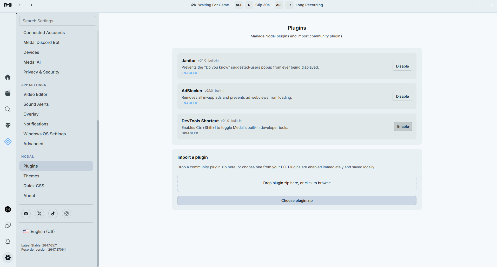
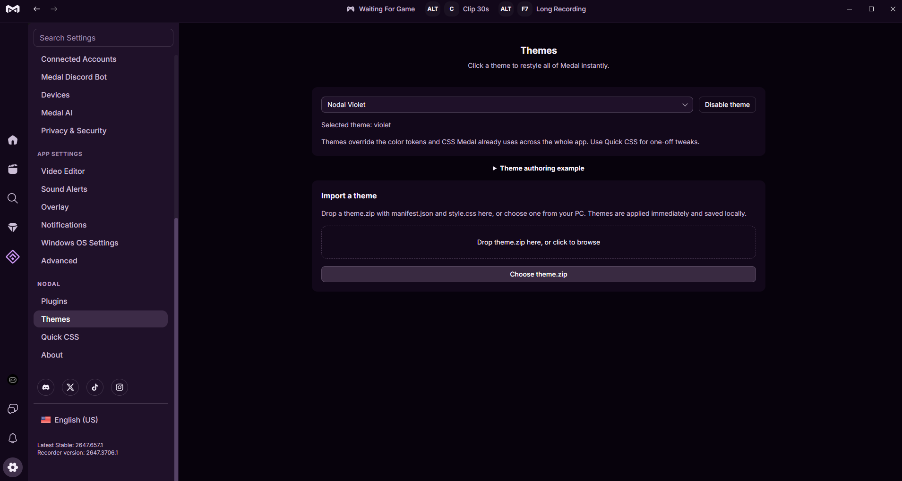
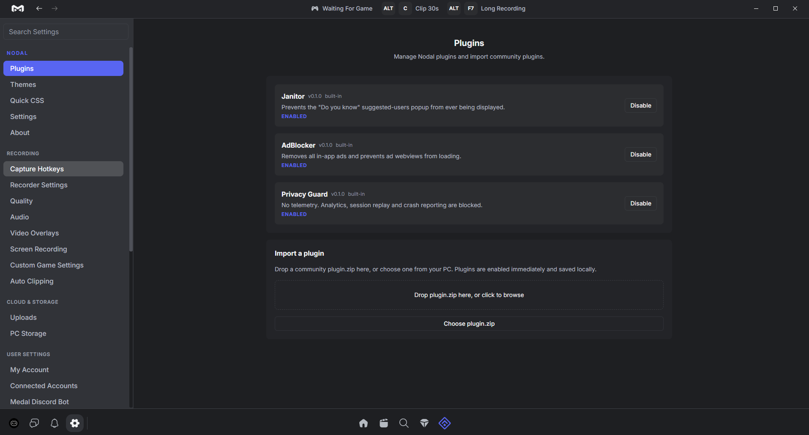

# Nodal

**Extend Medal. Customize everything.**

Nodal is an extension for Medal that introduces additional functionality through custom plugins, themes, and personalization tools.

---

## Installation

### Download

Download the latest version from [GitHub Releases](https://github.com/krushna06/Nodal/releases) and run `NodalInstaller.exe`.

### Build from Source

Run the installer script from the repository root:

```powershell
powershell -NoProfile -ExecutionPolicy Bypass -File .\installer\install.ps1
```

The installer provides an interactive menu:

```text
Use the arrow keys to navigate:

? What would you like to do?
  > Install Nodal
    Repair Nodal
    Uninstall Nodal
```

---

## Screenshots

<table>
  <tr>
    <td colspan="2" align="center">
      <b>Plugin Management</b><br><br>
      
    </td>
  </tr>
  <tr>
    <td align="center">
      <b>Theme Preview — 01</b><br><br>
      
    </td>
    <td align="center">
      <b>Theme Preview — 02</b><br><br>
      
    </td>
  </tr>
  <tr>
    <td colspan="2" align="center">
      <b>Theme Preview — 03</b><br><br>
      
    </td>
  </tr>
</table>

---

## Features

### Plugin System

Nodal includes built-in plugins that extend Medal's functionality:

| Plugin | Description |
|---|---|
| `janitor` | Built-in cleanup functionality |
| `adblocker` | Built-in ad-blocking functionality |
| `privacy` | Built-in privacy functionality |
| `devtools` | Developer tools |

#### Creating Custom Plugins

Use the example plugin in `src/userplugins/example-plugin/` as a starting point:

```text
example-plugin/
├── manifest.json   # Plugin metadata
├── index.js        # Start and stop hooks
└── style.css       # Styles loaded while enabled
```

To create your own plugin:

1. Copy the example plugin directory.
2. Update the `id` and `name` in `manifest.json`.
3. Implement your functionality in `index.js`.
4. Add optional styles in `style.css`.
5. Rebuild Nodal.

**Plugin manifest requirements:**
- `id` must be lowercase.
- `name` defines the plugin's display name.
- `entry` defaults to `index.js`.
- `style.css` is detected automatically.

The example plugin is excluded from the Plugins UI. Only usable plugins are displayed.

#### Installing Plugins

Navigate to **Settings → Nodal → Plugins**.

You can import plugins by selecting or dropping a `plugin.zip` containing the required files.

- Imported plugins are enabled immediately.
- Plugins persist locally between sessions.
- Imported plugins can be removed from the same settings page.

Quick CSS provides separate **Apply** and **Clear** actions.

---

### Theme System

Nodal includes nine built-in themes:

- Nodal Dark
- Nodal Violet
- Nodal Light
- Nodal Ocean
- Nodal Emerald
- Nodal Rose
- Nodal Amber
- Nodal Nord
- Nodal Reimagined

#### Creating Built-in Themes

Adding a built-in theme requires two steps:

1. Add a CSS file to `src/themes/` using the theme ID as its filename.
2. Register its descriptor in `src/core/runtime.js`.

The build automatically includes every CSS file in the themes directory.

#### Theme Customization

Nodal themes can restyle the entire Medal interface by overriding its existing design tokens.

Some commonly used tokens include:

```css
--color-first-layer
--color-third-layer
--color-foreground-0
--color-stroke-0
--color-brand-primary-*
--sidebar
--scrollbar-*
```

Theme stylesheets can target any Medal element, not just Nodal components.

The active theme ID is also exposed through the following HTML attribute:

```html
<html data-nodal-theme="theme-id">
```

#### Installing Custom Themes

Navigate to **Settings → Nodal → Themes**.

Select a built-in theme to apply it instantly, or import a custom theme by selecting or dropping a `theme.zip`.

**Theme package structure:**

```text
theme.zip
├── manifest.json   # Theme metadata and optional token overrides
└── style.css       # Custom CSS for Medal (optional)
```

**Example `manifest.json`:**

```json
{
  "id": "my-theme",
  "name": "My Theme",
  "description": "Purple Medal.",
  "version": "1.0.0",
  "variables": {
    "--color-third-layer": "oklch(22% 0.05 310)"
  },
  "style": "style.css"
}
```

The `style.css` file is optional when `variables` is provided.

Both token-only and CSS-only themes are supported.

Imported themes:
- Apply immediately after import.
- Persist locally between sessions.
- Can be removed through the Themes settings page.

#### Quick CSS & Developer Tools

Use **Quick CSS** to apply temporary customizations on top of your active theme.

To inspect the currently active theme tokens, run the following in Medal DevTools:

```javascript
Nodal.themes.tokens()
```

---

## Development

### Build

Build the project from the repository root:

```powershell
powershell -NoProfile -ExecutionPolicy Bypass -File .\build\build.ps1
```

### Development Mode

Launch the development environment:

```powershell
powershell -NoProfile -ExecutionPolicy Bypass -File .\build\launch-dev.ps1
```

### Testing & Verification

Run the runtime tests:

```bash
node .\scripts\test-runtime.js
```

Verify the installer:

```powershell
powershell -NoProfile -ExecutionPolicy Bypass -File .\installer\verify.ps1
```

---

## Project Structure

```text
Nodal/
├── build/                  # Build and development scripts
├── installer/              # Installation and verification scripts
├── scripts/                # Runtime tests and utilities
├── screenshots/            # README screenshots
└── src/
    ├── core/               # Core runtime
    ├── themes/              # Built-in themes
    └── userplugins/         # Plugin templates and user plugins
```

---

## License

Nodal is licensed under the **GNU General Public License v3.0 (GPL-3.0)**.

See [LICENSE](LICENSE) for details.